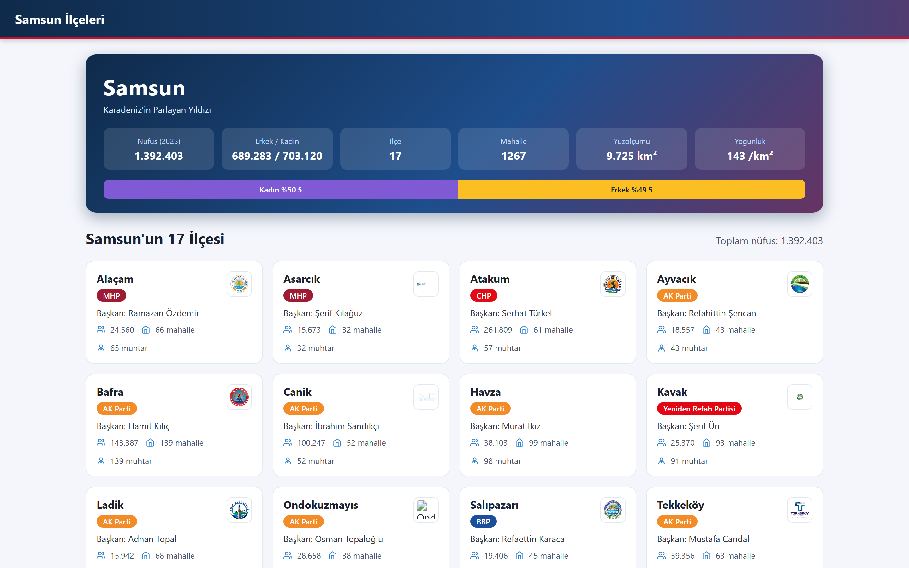
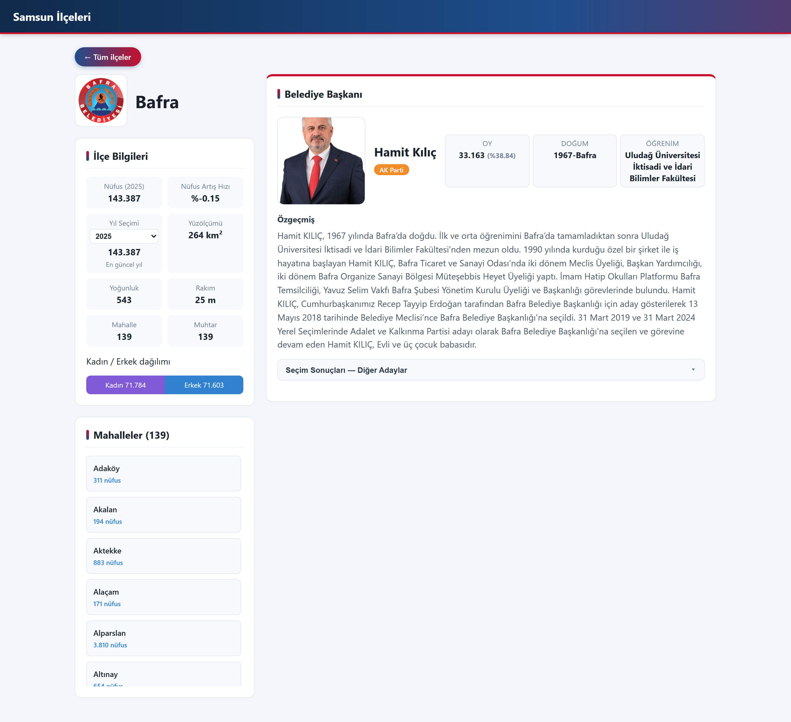
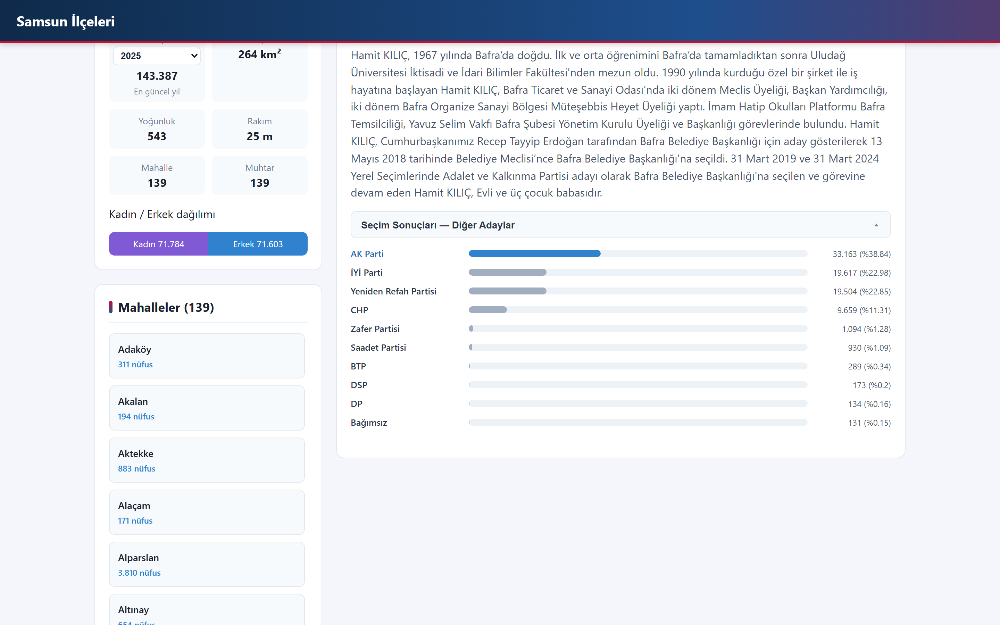
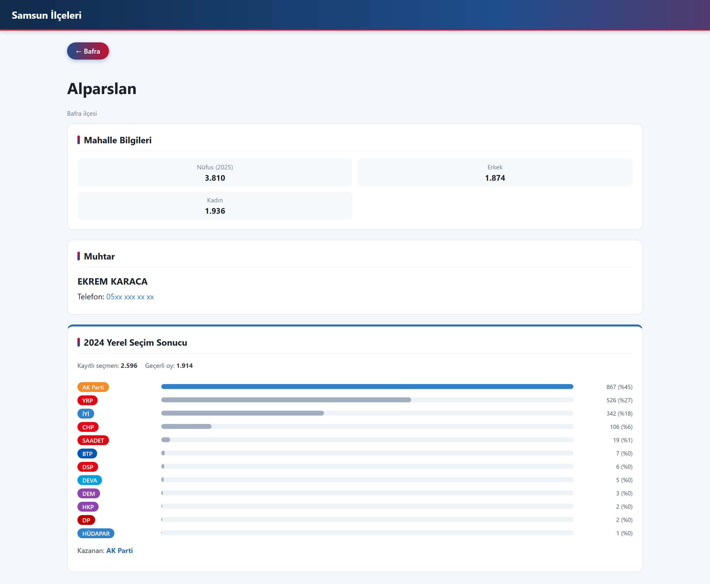

# Samsun Districts Explorer

> **Showcase repository.** The source code of this project is private. This repository contains only documentation and screenshots. Code walkthroughs are available on request.

A data platform that collects up-to-date information about all **17 districts of Samsun** and presents it in a clean React interface. Scrapers gather mayors, neighbourhood heads (muhtars), neighbourhoods, population figures, election results and municipal activities from public, official sources.



## Features

- **Province and district overview.** Shows population by year, gender distribution, area, density and elevation for the province and each district.
- **Mayor profiles.** Includes a photo, party, vote share and biography, plus a breakdown of the 2024 local election for all candidates.
- **Neighbourhood level.** Shows population, the neighbourhood head and ballot-box-level 2024 election results for every neighbourhood (1,267 in total).
- **Live news.** Fetches recent news from the district municipalities' sites on demand, with a 15-minute cache.

## Data pipeline

```
Official sources ──► Scrapers (ASP.NET Core)
  district municipality & governorship sites   ├─ static HTML parsing
  Wikipedia                                    ├─ Playwright/Chromium for JS-rendered pages
  population data (TÜİK ADNKS based)           └─ YSK election results client
  YSK (Supreme Election Council)
                          │
                          ▼
                    SQLite database ──► REST API (/api/ilce/...) ──► React + Vite UI
```

## Tech stack

| Layer | Technology |
| --- | --- |
| Backend | ASP.NET Core (.NET 10) Web API |
| Scraping | HttpClient + HTML parsing, Microsoft Playwright for JS-rendered pages |
| Storage | SQLite |
| Frontend | React, Vite, React Router |

## Screenshots

| District detail | Election results | Neighbourhood |
| --- | --- | --- |
|  |  |  |

Personal contact details (phone numbers) are masked in the screenshots.

---

This is an independent project and is not an official product of any municipality.
© Mert Olgun. All rights reserved.
