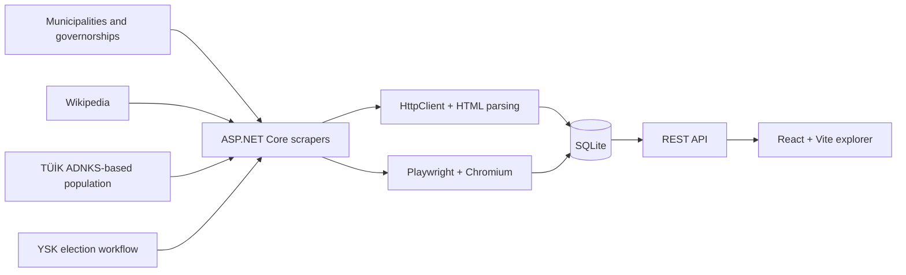

# Samsun Districts Explorer

> A scraper-driven civic data platform covering Samsun's 17 districts, 1,267 neighbourhoods, population trends and 2024 local-election results.

> [!IMPORTANT]
> This is an independent portfolio project. It is **not an official product of a municipality or public institution**.

This is a **documentation-only showcase**. The source code is private; a guided code walkthrough is available on request.

| Coverage | Data flow | Stack |
| --- | --- | --- |
| 17 districts · 1,267 neighbourhoods | Public sources → scrapers → SQLite → REST API → React | ASP.NET Core, Playwright, SQLite, React |

## The problem

District-level public information is fragmented across municipality pages, governorship sites, population records and election sources. Comparing districts—or moving from a district down to neighbourhood-level detail—requires many separate searches.

The project brings that information into a consistent explorer while preserving the distinction between collected facts, source freshness and presentation.

## My role

I designed the multi-source scraping workflow, normalised data model, ASP.NET Core API and React interface. I also handled JavaScript-rendered sources with Playwright and reconciled district, neighbourhood and neighbourhood-head records.

## Data pipeline

## What users can explore

- **Province and district overview:** population by year, gender distribution, area, density and elevation.
- **Mayor profiles:** portrait, party, vote share, biography and the full 2024 candidate breakdown.
- **Neighbourhood detail:** population, neighbourhood head and ballot-level election results for all 1,267 neighbourhoods.
- **Recent municipal activity:** district news fetched on demand with a 15-minute cache.

## Engineering decisions

### Match the collector to the source

Static sources use HttpClient and HTML parsing. JavaScript-rendered pages use Playwright and Chromium rather than assuming every source can be scraped through one brittle method.

### Normalise before presentation

District, neighbourhood, mayor and election records are reconciled into stable entities before the React layer consumes them. This keeps source-specific inconsistencies out of the UI contract.

### Balance freshness and source load

Recent district news is loaded on demand and cached for 15 minutes. More stable demographic and election data is persisted in SQLite.

## Data quality and privacy

- The UI distinguishes stable stored data from on-demand municipal news.
- Public screenshots mask personal contact information such as phone numbers.
- Source changes and scraper failures are treated as operational concerns that should be measured and surfaced.
- The showcase does not imply endorsement by Samsun Metropolitan Municipality, district municipalities, TÜİK or YSK.

## Evidence available today

The application covers all 17 Samsun districts and 1,267 neighbourhoods and demonstrates a complete data-product workflow: acquisition, browser automation, normalisation, persistence, API design and user-facing exploration.

## Screenshots

| District detail | Election results |
| --- | --- |
|  |  |

## Technology

| Layer | Technology |
| --- | --- |
| Backend | ASP.NET Core (.NET 10) Web API |
| Collection | HttpClient, HTML parsing, Microsoft Playwright, Chromium |
| Storage | SQLite |
| Frontend | React, Vite, React Router |

## Next steps

- Publish per-source update timestamps and coverage indicators.
- Add retry, alerting and historical scraper-health dashboards.
- Add automated consistency checks for population, mayor and election data.
- Introduce map-based district comparison and more visual trend summaries.
- Publish a source catalogue describing provenance and update policy.

## Privacy and ownership

The screenshots and documentation are shared for portfolio review only. See [LICENSE.md](LICENSE.md).

© Mert Olgun. All rights reserved.
